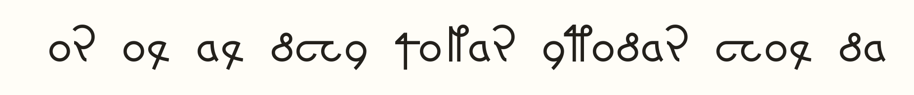

# Voynich experimental

A tiny autoregressive transformer trained on EVA transcription of the Voynich manuscript. This is the exact reference checkpoint used by the `voynich-experimental` JNAIQ integration, packaged for standalone CPU use.

It generates manuscript-like EVA text. It has no established translation or decipherment ability, English instruction training, or learned chat roles.

## Run locally

Requires Python 3.11 or newer. Clone the repository and create an environment:

```sh
git clone https://github.com/several-dozen-lizards/voynich-experimental.git
cd voynich-experimental
python -m venv .venv
```

Activate the environment (`.venv\Scripts\activate` on Windows, or `source .venv/bin/activate` on macOS/Linux), then:

```sh
python -m pip install -r requirements.txt
python generate.py --prompt "qokedy chedy" --seed 42 --max-tokens 32
python server.py
```

The example generation produces:

```text
 or ol al dchy qokar ytodar chol da
```

The same output rendered in [Fairfax EVA HD](https://github.com/kreativekorp/voynich-unicode), so you can see the glyphs without installing a font:



This changes the appearance of the EVA text only; it is not a translation. [Sample and font provenance](assets/voynich-output.json).

The initial space is part of the generated continuation. Seeded sampling is reproducible in the verified PyTorch environment; exact samples may vary across PyTorch versions or platforms.

The server listens on `http://127.0.0.1:8767`. Its OpenAI-compatible base URL is `http://127.0.0.1:8767/v1`, model ID `voynich-experimental`. Endpoints: `/health`, `/v1/models`, `/v1/chat/completions`. A local client may use a placeholder API key. Do not expose this unauthenticated local server to the internet.

## Fonts and further reading

### Show the output as Voynich glyphs

[Fairfax EVA HD](https://github.com/kreativekorp/voynich-unicode/blob/master/Fairfax/FairfaxEVAHD.ttf) is an EVA-encoded font from Rebecca Bettencourt / Kreative Software's [Voynich Unicode font package](https://github.com/kreativekorp/voynich-unicode). It is the font used for this model's glyph display in JNAIQ.

Download the `.ttf` using GitHub's **Download raw file** button, install it, then paste generated EVA text into an editor that lets you select **Fairfax EVA HD**. GitHub's README code blocks will continue to show ordinary Latin characters.

Choose the **EVA** font for this model's output; the package also includes fonts with different encodings. Changing the font changes presentation only. It does not translate the text, and the model's normalized EVA does not preserve every manuscript ligature or scribal variation.

### Explore the manuscript

- [Yale's digitized manuscript](https://collections.library.yale.edu/catalog/2002046) — high-resolution images of Beinecke MS 408.
- [Beinecke Library's introduction](https://beinecke.library.yale.edu/beinecke/collections/beinecke-cipher-voynich-manuscript) — manuscript background, provenance, and access information.
- [René Zandbergen's Voynich site](https://www.voynich.nu/) — manuscript history and research reference material.
- [Transliteration guide and source files](https://www.voynich.nu/transcr.html) — EVA and other conventions for representing the handwriting as computer-readable text, including the Zandbergen–Landini source used by this model.

## Model

- 3,189,035 parameters; four transformer layers, 256-dimensional embeddings, four attention heads.
- T2 clustered EVA tokenization with known pre-target position events.
- 64 model-token context; longer prompts retain only their suffix. Requests do not expand this context.
- CPU inference, two PyTorch threads; maximum 256 generated pieces per request.
- Messages are joined as plain text. Unknown prompt pieces become UNK. No trained end-of-sequence token; generation ends at the budget or supplied stop string.
- SSE output is buffered until generation finishes. Tools, images, and structured outputs are unsupported.

Training used seed 1729 and a fixed 96-step budget, with validation selection at the registered checkpoints. The saved model was still improving at the budget limit; it is not convergence-qualified. Original run metadata and metrics are under `provenance/`; this package does not reproduce the full training or research pipeline.

Checkpoint SHA-256: `9342df1f11f874676dc0dd3e8ba8409ca158d1e8474077aa42644302182b6651`.

## Provenance and rights

The training corpus was the Zandbergen-Landini EVA transcription, `ZL3b-n.txt`, downloaded on 2026-10-26 from [voynich.nu](https://www.voynich.nu/data/ZL3b-n.txt), catalogued on the [transcription page](https://www.voynich.nu/transcr.html). Source SHA-256: `bf5b6d4ac1e3a51b1847a9c388318d609020441ccd56984c901c32b09beccafc`.

Raw transcription, manuscript images, research corpora, JNAIQ configuration, resident records, and conversations are excluded. Public downloadability does not establish a redistribution license for the transcription. No license for that source is inferred here, and no blanket license is granted for this repository at this release. Public availability of the code and weights is not a grant of reuse rights.

The architecture and tokenizer were copied from the original local lab. The gateway was copied from its JNAIQ integration with only portable package/checkpoint defaults changed. `generate.py` adds a command-line entry point. The weights are byte-for-byte unchanged.

## Verify

```sh
python -m unittest discover -s tests -v
```

Tests check checkpoint identity, model limits, reproducible generation, long-prompt handling, and the real HTTP JSON/SSE endpoints using synthetic prompts. No training is performed.

The release verification passed all four tests with the unchanged reference checkpoint. See [the verification receipt](provenance/VERIFICATION.json) and [file hashes](provenance/FILES.sha256.json).

## Occult disclaimer

The author accepts no responsibility for demons summoned, time travelers burned at the stake for sorcery, bad astrology, or other malignancies associated with use of this model. Exorcism support is outside the scope of this repository.
